# What is RCU, Fundamentally?

## 引言
读-拷贝更新（RCU，Read-copy update）是 2002 年 10 月加入 Linux 内核的一种同步机制。RCU 通过允许读操作与更新操作并发执行，提升了系统的可扩展性。
传统锁原语会对所有并发线程（无论读者还是更新者）强制互斥；读写锁虽然支持并发读，但一旦存在更新就不允许读。和它们不同，RCU 支持 **一个更新者与多个读者并发运行**。
RCU 通过维护对象的多个版本、并且保证旧版本不会被释放，直到所有先前启动的读侧临界区全部执行完毕，以此保证读操作的一致性。
RCU 定义并使用一套高效、高可扩展的机制：用于发布、读取对象的新版本，同时延迟（deferring）回收旧版本。
这套机制把开销分摊到读路径和更新路径上，让 **读路径的开销极低**。在部分场景下（不可抢占内核），RCU 的读侧原语开销为零。

**快速自测题1：** 那顺序锁（seqlock）不也允许读端和更新端并发执行吗？

这就引出一个问题：“RCU 到底是什么？”，或许还会附带另一个问题：“RCU 这东西凭什么能正常工作？”（也经常会看到一种论调，说 RCU 根本就不可能正常工作）。
本文从底层原理角度解答这些问题；后续篇章会从使用方式和API接口的角度展开说明。最后一篇还会附上参考文献列表。

RCU 由三大基础机制构成：第一个用于插入操作，第二个用于删除操作，第三个让读端可以容忍并发的插入与删除。
下面分小节讲解这些机制，以 RCU 在链表上的应用为例展开说明：
- [发布-订阅机制](#发布-订阅机制publish-subscribe-mechanism)（Publish-Subscribe，用于插入）
- [等待已存在的 RCU 读端临界区执行完毕](#等待已启动的-rcu-读端临界区执行完毕)（用于删除）
- [为新近更新的对象维护多个版本](#为新近更新的对象维护多个版本)（服务于读端）

以上小节之后是 [总结] 以及 [快速自测题答案]。

## 发布-订阅机制（Publish-Subscribe Mechanism）

RCU 的一个核心特性：**即使数据正在被并发修改，读端依然可以安全地遍历该数据**。为支持并发插入，RCU 采用了一种可理解为发布-订阅的机制。
举个例子：有一个初始值为 `NULL` 的全局指针 `gp`，我们要修改它，让它指向一块刚分配并完成初始化的数据结构。
可以用下面这段代码片段（还需要搭配合适的锁保护）实现这个目的：
```c
struct foo {
   int a;
   int b;
   int c;
};
struct foo *gp = NULL;
 
/* . . . */

p = kmalloc(sizeof(*p), GFP_KERNEL);
p->a = 1;
p->b = 2;
p->c = 3;
gp = p;
```

但这段代码存在问题：**没有任何约束强制编译器和 CPU 按顺序执行最后四条赋值语句**。
如果对 `gp` 的赋值先于 `p` 成员字段的初始化完成，那么并发的读端就有可能读到未初始化的脏值。
这种场景需要内存屏障来保证顺序，而内存屏障本身以难用、容易出错著称。因此内核把屏障逻辑封装成原语 `rcu_assign_pointer()`，它自带 **发布语义（publication semantics）**。修改后最后四行代码如下：
```c
p->a = 1;
p->b = 2;
p->c = 3;
rcu_assign_pointer(gp, p);
```

`rcu_assign_pointer()` 负责 *发布* 这个新结构体：它会强制编译器与 CPU，保证对 `gp` 的赋值，一定在 `p` 指向的各个字段赋值完成 *之后* 执行。

但仅仅在更新端保证执行顺序还不够，**读端同样必须保证正确的访存顺序**。请看下面这段代码片段：
```c
p = gp;
if (p != NULL) {
    do_something_with(p->a, p->b, p->c);
}
```

这段代码乍一看似乎不会发生乱序问题，但不巧的是，[DEC Alpha CPU](http://www.rdrop.com/users/paulmck/scalability/paper/ordering.2007.09.19a.pdf)，以及 **值推测（value-speculation）** 类编译器优化，真的可以让 `p->a`、`p->b`、`p->c` 的读取先于指针 `p` 的读取！
用值推测优化的场景最好理解：编译器会预先猜测 `p` 的值，提前加载 `p->a`、`p->b`、`p->c`，之后再读取真实的 `p`，校验刚才的猜测是否成立。这类优化非常激进，甚至可以说近乎离谱，但在基于采样反馈的配置驱动优化（profile-driven optimization）中确实会出现。

显然，我们需要阻止编译器和 CPU 做出这类“小动作”。原语 `rcu_dereference()` 会按需插入内存屏障指令以及编译器屏障，用来达成这个目的：
```c
rcu_read_lock();
p = rcu_dereference(gp);
if (p != NULL) {
    do_something_with(p->a, p->b, p->c);
}
rcu_read_unlock();
```

因此可以把 `rcu_dereference()` 理解为 **订阅** 指定指针的取值：它能保证后续对该指针成员的解引用，一定可以看到对应发布操作（`rcu_assign_pointer()`）之前完成的全部初始化。
`rcu_read_lock()` 和 `rcu_read_unlock()` 是必不可少的：它们划定了 **RCU 读端临界区** 的范围。它们的作用会在下一节说明；重点是：这两个函数 **不会自旋、不会阻塞**，也不会阻止 `list_add_rcu()` 并发执行。实际上，在未开启 `CONFIG_PREEMPT` 的内核中，这两个调用不会生成任何机器码。

理论上，仅凭 `rcu_assign_pointer()` 和 `rcu_dereference()` 就可以构造任意受 RCU 保护的数据结构，但工程实践中，使用更高层封装会更方便。
所以这两个原语已经被封装进 Linux 链表操作 API 的 RCU 专用版本里。
Linux 提供两种双向链表：环形的 `struct list_head`，以及线性的 `struct hlist_head / struct hlist_node` 组合。
前者的布局如下，其中绿色方框代表链表头，蓝色方框代表链表节点。


把上面指针发布的示例改造为链表版本，代码如下：
```c
  1 struct foo {
  2   struct list_head list;
  3   int a;
  4   int b;
  5   int c;
  6 };
  7 LIST_HEAD(head);
  8 
  9 /* . . . */
 10 
 11 p = kmalloc(sizeof(*p), GFP_KERNEL);
 12 p->a = 1;
 13 p->b = 2;
 14 p->c = 3;
 15 list_add_rcu(&p->list, &head);
```

第 15 行需要通过某种同步机制（最常用的是锁）加以保护，避免多个 `list_add()` 并发执行。但这套同步机制 **不会阻止本次 `list_add_rcu()` 和 RCU 读端并发运行**。

订阅受 RCU 保护的链表也很简单：
```c
rcu_read_lock();
list_for_each_entry_rcu(p, head, list) {
  do_something_with(p->a, p->b, p->c);
}
rcu_read_unlock();
```

原语 `list_add_rcu()` 将一个节点发布到指定链表；它保证对应的 `list_for_each_entry_rcu()` 遍历宏可以正确订阅到这个新增节点。

**快速自测题2：** 如果 `list_for_each_entry_rcu()` 和 `list_add_rcu()` 恰好同时执行，是什么机制避免了段错误？

Linux 的另一种双向链表是哈希链表（hlist），它是线性链表。环形链表的链表头需要两个指针，而 hlist 的表头只需要一个指针。因此，在大容量哈希表的哈希桶数组中使用 hlist，可以将内存占用减少一半。


向受 RCU 保护的 hlist 发布新节点，操作和环形链表非常相似：
```c
  1 struct foo {
  2   struct hlist_node *list;
  3   int a;
  4   int b;
  5   int c;
  6 };
  7 HLIST_HEAD(head);
  8 
  9 /* . . . */
 10 
 11 p = kmalloc(sizeof(*p), GFP_KERNEL);
 12 p->a = 1;
 13 p->b = 2;
 14 p->c = 3;
 15 hlist_add_head_rcu(&p->list, &head);
```

和前面一样，第 15 行代码必须由同步机制（例如锁）保护。

遍历受 RCU 保护的 hlist 的方式也和环形链表类似：
```c
rcu_read_lock();
hlist_for_each_entry_rcu(p, q, head, list) {
  do_something_with(p->a, p->b, p->c);
}
rcu_read_unlock();
```

**快速自测题 3**：为什么 `hlist_for_each_entry_rcu()` 需要传入两个临时指针，而 `list_for_each_entry_rcu()` 只需要一个？

下表列出了全部 RCU 发布、订阅原语，另外还包含用于 “取消发布”（也就是撤销节点）的原语：

Category     | Publish              | Retract                       | Subscribe
-------------|----------------------|-------------------------------|-----------------
**Pointers** | rcu_assign_pointer() | rcu_assign_pointer(..., NULL) | rcu_dereference()
**Lists**    | list_add_rcu()</br>list_add_tail_rcu()</br>list_replace_rcu() | list_del_rcu() | list_for_each_entry_rcu()
**Hlists**   | hlist_add_after_rcu()</br>hlist_add_before_rcu()</br>hlist_add_head_rcu()</br>hlist_replace_rcu() | hlist_del_rcu() | hlist_for_each_entry_rcu()

需要注意，`list_replace_rcu()`、`list_del_rcu()`、`hlist_replace_rcu()`、`hlist_del_rcu()` 这几组接口会带来一个复杂问题：**什么时候才可以安全释放被替换或者被删除的数据节点？** 更具体一点：我们要如何确认，所有读端都已经不再持有该数据节点的引用？

下一节将解答这些问题。

## 等待已启动的 RCU 读端临界区执行完毕
从最根本的形态来看，RCU 就是一种等待任务完成的机制。当然，实现等待的方式还有很多，比如引用计数、读写锁、事件等等。
RCU 的突出优势在于：它可以同时等待（举例来说）20000 个不同的执行流结束，却不需要逐个显式追踪每一个；同时也不会出现显式追踪方案自带的性能下降、可扩展性瓶颈、复杂死锁场景以及内存泄露风险。

在 RCU 中，等待的对象叫做 **RCU 读端临界区**。一个 RCU 读端临界区以 `rcu_read_lock()` 原语开始，以配对的 `rcu_read_unlock()` 原语结束。
RCU 读端临界区支持嵌套，内部几乎可以放置任意代码，但 **不能主动阻塞或睡眠**（有一种特殊的 RCU 实现 [SRCU]，允许在它的读端临界区内睡眠）。
只要遵守这条规则，你就可以利用 RCU 等待指定代码段执行完成。

[经典 RCU] 和 [实时 RCU] 的相关文档里已经讲过：RCU 是通过间接判定的方式，获知这些读端何时执行完毕。

如下图所示：RCU 的作用，就是等待 **在删除操作之前就已经启动** 的那些 RCU 读端临界区（译注：最下面两个 Reader）全部执行完成，包括这些临界区内所有的内存访问操作。


译注：删除操作的发布即启动一个宽限期（上图中黄色区域最左边的一条线）。发布之前的 Reader 看到的是旧数据，发布之后的 Reader 看到的是新数据。然而即该宽限期需要等到最下面一个 Reader 结束的才能结束（上图中黄色区域最右边的一条线），回收旧数据。

但是请注意：**在某个宽限期（grace period）启动之后才开始的 RCU 读端临界区（译注：除最右边两个 Reader 外的其他 Reader），完全可以、也确实会运行到该宽限期结束之后**。

下面这段伪代码展示了利用 RCU 等待读端完成的基础算法流程：
1. 执行修改操作，例如替换链表中的一个节点。
2. 等待所有在宽限期开始前就已启动的 RCU 读端临界区全部执行完毕（可以使用原语 `synchronize_rcu()`）。这里的核心逻辑是：**宽限期之后新产生的读端，已经无法拿到刚才被移除节点的引用**。
3. 清理资源，比如释放上面被替换掉的节点。

下面的代码片段改编自上一节示例，演示整个流程，其中成员 `a` 作为检索键：
```c
 1 struct foo {
 2   struct list_head list;
 3   int a;
 4   int b;
 5   int c;
 6 };
 7 LIST_HEAD(head);
 8 
 9 /* . . . */
10 
11 p = search(head, key);
12 if (p == NULL) {
13   /* 执行对应处理、解锁并返回 */
14 }
15 q = kmalloc(sizeof(*p), GFP_KERNEL);
16 *q = *p;
17 q->b = 2;
18 q->c = 3;
19 list_replace_rcu(&p->list, &q->list); //GP 开始，在此之前的读端看到的是旧链表，在此之后的读端看到的是新链表
20 synchronize_rcu();                    //GP 结束，阻塞式等待在删除操作之前就已经启动的那些 RCU 读端临界区全部执行完成
21 kfree(p);
```

第 19、20、21 行，正好对应上面所说的三步。
第 16～19 行的逻辑，正是 RCU（read-copy update，读-拷贝-更新）名字的由来：它允许 *读端* 并发访问；第 16 行执行拷贝，17–19 行完成 *更新*。

`synchronize_rcu()` 这个原语初看会有点难以理解：它需要等待全部旧的 RCU 读端临界区结束，而前面我们已经看到，在未开启 `CONFIG_PREEMPT` 的内核中，用来标记读临界区边界的 `rcu_read_lock()` 和 `rcu_read_unlock()` 甚至不会生成任何机器码！

这里有一个关键诀窍：经典 RCU 中由 `rcu_read_lock()` 和 `rcu_read_unlock()` 划定的读端临界区 **不允许阻塞或睡眠**。
因此，当某个 CPU 发生上下文切换时，我们就可以断定：该CPU 上之前启动的所有 RCU 读端临界区都已经执行完毕。
也就是说，只要每一个 CPU 都至少完成一次上下文切换，那么所有在此之前启动的 RCU 读端临界区必然全部结束，此时 `synchronize_rcu()` 就可以安全返回。

因此从原理上理解，经典 RCU 的 `synchronize_rcu()` 可以简化成下面这样：
```c
1 for_each_online_cpu(cpu)
2    run_on(cpu);
```

其中 `run_on()` 会把当前线程调度到指定 CPU 上运行，强制该 CPU 产生一次上下文切换。
这个 `for_each_online_cpu()` 循环会让每个在线 CPU 都发生一次上下文切换，以此保证所有先前的 RCU 读端临界区执行完成。
这种简单思路适用于 RCU 读临界区内禁止抢占的内核，也就是 `CONFIG_PREEMPT` 和非抢占内核；**但不适用于 `CONFIG_PREEMPT_RT` 实时（-rt）内核**。所以实时 RCU 采用了一套不同的实现方案，大体上基于引用计数思想。

当然，Linux 内核里的真实实现要复杂得多：它需要处理中断、NMI、CPU 热插拔以及商用内核里的各类异常场景，同时还要保证不错的性能与可扩展性。
而 RCU 的实时版本还必须保障良好的实时响应延迟，因此像上面这种依赖关闭抢占的简易实现就不可用了。

理解 `synchronize_rcu()` 这个简化原理很有帮助，但还有别的问题待解答。例如：读端遍历一个正在被并发更新的链表时，到底会读到什么内容？下一节就来回答这个问题。

## 为新近更新的对象维护多个版本
本节将说明 RCU 如何维护链表的多版本，从而支持无需同步的读端。
文中给出两个示例，用来阐释一条核心规则：只要某个读端还处在 RCU 读端临界区内，该读端可能正在引用的节点就必须保持完好可用。
第一个示例演示链表节点的删除，第二个演示节点替换。

### 示例 1：删除操作期间维护多版本

我们从“删除”示例开始，对 [上一节示例](#等待已启动的-rcu-读端临界区执行完毕) 的第 11–21 行代码做如下修改
```c
1 p = search(head, key);
2 if (p != NULL) {
3   list_del_rcu(&p->list);
4   synchronize_rcu();
5   kfree(p);
6 }
```

链表的初始状态（包含指针 `p`）说明如下：


每个节点里的三元组分别代表字段 `a`、`b`、`c` 的值。节点上的红色边框表示：读端可能持有该节点的引用；由于读端和更新端之间不做直接同步，读端可以和这一整套替换流程并发执行。
为了简洁，图中省略了反向指针，以及链表尾指向链表头的链接。

第 3 行的 `list_del_rcu()` 执行完毕后，节点 `(5,6,7)` 已经从链表中摘除，如下图所示。
因为读端与更新端无直接同步，读端可能正在并发遍历该链表。这些并发读端能否看到这个刚被摘除的节点，取决于时序。
但是，如果某个读端在拿到这个待摘除节点的指针之后被延迟（例如被中断、ECC 内存错误，或是在开启 `CONFIG_PREEMPT_RT` 的内核中被抢占），那么在节点被摘除之后的很长一段时间里，该读端仍然可以访问链表的旧版本。
于是此时链表就存在两个版本：一个版本包含节点 `(5,6,7)`，另一个版本不包含它。
节点 `(5,6,7)` 的边框依旧为红色，代表仍有读端可能正在引用它。

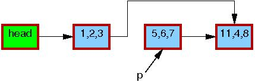

请注意：读端在退出 RCU 读端临界区之后，不允许继续持有节点 `(5,6,7)` 的引用。
因此，当第 4 行的 `synchronize_rcu()` 返回时，所有在它之前启动的读端临界区都已经保证执行完成，不再有任何读端会引用该节点，对应节点边框变为黑色。此时链表回到单一版本。

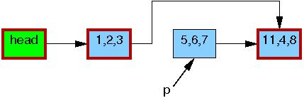

到这一步，就可以安全释放节点 `(5,6,7)` 的内存，如下图：


至此，节点 `(5,6,7)` 的删除流程完成。下一节介绍节点替换操作。

### 示例 2：替换操作期间维护多版本

我们开始讲解替换示例，先给出上一个示例的后续代码片段：
```c
1 q = kmalloc(sizeof(*p), GFP_KERNEL);
2 *q = *p;
3 q->b = 2;
4 q->c = 3;
5 list_replace_rcu(&p->list, &q->list);
6 synchronize_rcu();
7 kfree(p);
```

链表初始状态（包含指针 `p`）和删除示例完全一致：

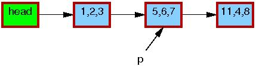

和之前一样，每个节点中的三元组依次代表字段 `a`、`b`、`c` 的值。
节点红色边框代表读端可能持有该节点引用；由于读端与更新端之间没有直接同步，读端可以和整个替换流程并发执行。
为便于理解，这里同样省略了反向指针以及链表尾指向链表头的链接。

第 1 行：调用 `kmalloc()` 分配用于替换的新节点：

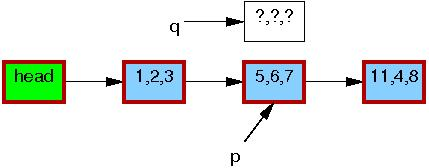

第 2 行：将旧节点内容拷贝到新节点：


第 3 行：把 `q->b` 修改为 `2`：


第 4 行：把 `q->c` 修改为 `3`：

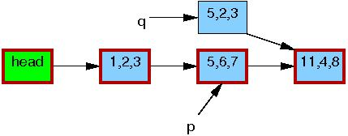

第 5 行执行替换动作，新节点至此对读端可见。
此时链表存在两个版本：在替换之前就已经开始的老读端，仍然可以看到旧节点（`5,6,7`）；而新来的读端将看到新节点（`5,2,3`）。
但对于任意一个读端，它看到的链表一定是合法、完整的。

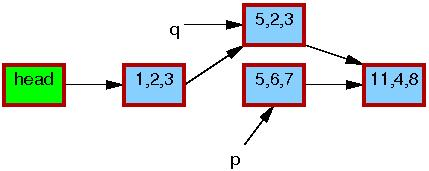

第 6 行 `synchronize_rcu()` 返回后，宽限期已经结束。所有在 `list_replace_rcu()` 之前发起的读操作都已经完成。
特别是，所有曾经持有旧节点（`5,6,7`）引用的读端，都已经退出 RCU 读端临界区，不再允许继续持有该引用。
旧节点（`5,6,7`）的边框变为细黑边，代表已经没有读端引用它。站在读端视角，链表变回单一版本，只是新节点替换掉了旧节点。

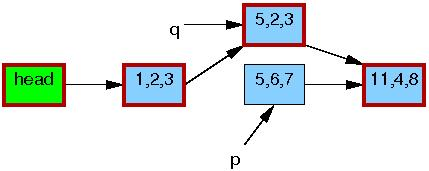

第7行 `kfree()` 执行完成后，链表状态如下：

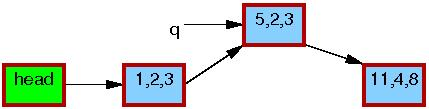

尽管 RCU 这个名字本身来源于 **替换场景**，但 Linux 内核里绝大多数 RCU 的实际使用，都是 [上一节](#示例-1删除操作期间维护多版本) 介绍的简单删除场景。


### 讨论

上面这些示例都假设：整个更新过程全程持有互斥锁，这意味着任意时刻，最多只会同时存在两个版本的链表。

**快速自测题 4**：如何修改删除示例，使得链表可以同时存在两个以上的有效版本？

**快速自测题 5**：一条链表在任意时刻，最多可以有多少个 RCU 版本同时生效？

上面这一系列流程展示了 RCU 更新是如何借助多版本机制，在存在并发读端的情况下安全完成数据修改。
当然，部分算法无法友好地处理多版本。有相关 [技术方案](http://www.rdrop.com/users/paulmck/RCU/RCUdissertation.2004.07.14e1.pdf) 可以改造这类算法以适配 RCU，但已经超出本文的讨论范围。

## 小结

本文介绍了基于 RCU 的算法的三大基础组成：
1. 用于新增数据的发布-订阅机制；
2. 等待已存在的 RCU 读端执行完毕的机制；
3. 维护多版本数据的规范，以此支持修改操作，而不会破坏并发读端，也不会不必要地阻塞读端。

**快速自测题6**：`rcu_read_lock()` 和 `rcu_read_unlock()` 原语既不忙等也不阻塞，那 RCU 更新端还有可能拖慢 RCU 读端吗？

RCU 的这三大组件，让数据在有并发读访问的场景下仍然可以被更新。它们能够以不同方式组合，实现种类非常丰富的 RCU 算法，其中一部分将在本系列《What is RCU, Really?》的下一篇中讲解。

## 致谢

本文初稿承蒙 Andy Whitcroft、Gautham Shenoy 以及 Mike Fulton 审阅，他们的意见极大完善了本文，在此深表谢意。感谢相对论编程项目（Relativistic Programming project）成员以及 PNW TEC 的各位同仁带来大量富有价值的讨论。感谢 Dan Frye 对本工作的支持。
最后，本研究内容基于美国国家科学基金会（National Science Foundation）资助项目（项目编号：CNS-0719851）完成。

本文仅代表作者观点，并不一定代表 IBM 或波特兰州立大学（Portland State University）的立场。

Linux 是 Linus Torvalds 的注册商标。

文中出现的其他公司、产品及服务名称，可能是对应主体的商标或服务商标。

## 快速自测题答案

**快速自测题 1**：seqlock 不是同样允许读端和更新端并发执行吗？

**答**：是，也不是。虽然 seqlock 的读端可以和写端并发运行，但一旦发生这种情况，`read_seqretry()` 原语会强制读端重试。也就是说，和更新端并发的 seqlock 读端此前做的所有计算都会被丢弃，需要重新执行。
因此 seqlock 读端虽然能和更新端并发跑，但这种情况下它无法真正完成有效工作。

与之不同，RCU 读端即使在更新端并发修改数据时，仍然可以完成有意义的工作。

**快速自测题 2**：如果 `list_for_each_entry_rcu()` 和 `list_add_rcu()` 恰好同时执行，为什么不会触发段错误？

**答**：在所有运行 Linux 的系统上，指针的加载与存储操作都是原子的。也就是说，当对同一个指针的读、写同时发生时，读操作只会拿到修改前的值或者修改后的值，绝不会拿到两者比特混杂的非法值。
除此之外，`list_for_each_entry_rcu()` 只会沿着链表向前遍历，不会回头访问。因此，它要么能看到 `list_add_rcu()` 新增的节点，要么看不到；无论哪种情况，它看到的链表都是合法、结构完整的。

**快速自测题 3**：为什么 `hlist_for_each_entry_rcu()` 需要传入两个指针，而 `list_for_each_entry_rcu()` 只需要一个？

**答**：因为 hlist（哈希链表）的终止条件是判断是否为 `NULL`，而不是判断是否碰到链表头。（你可以试着只用一个指针实现 `hlist_for_each_entry_rcu()`。如果你能想出优雅的实现方案，那会非常有价值！）

**快速自测题 4**：如何修改删除示例，让链表同时存在两个以上的有效版本？

**答**：一种实现方式如下：
```c
spin_lock(&mylock);
p = search(head, key);
if (p == NULL)
  spin_unlock(&mylock);
else {
  list_del_rcu(&p->list); //发布，开始一个新的 GP
  spin_unlock(&mylock);   //解锁之后其他路径可以拿到锁，然后发布，开启一个新的 GP
  synchronize_rcu();      //等待 GP 结束
  kfree(p);
}
```
注意：这样修改后，多个并发删除操作可能会阻塞在 `synchronize_rcu()` 处等待宽限期结束。

**快速自测题 5**：一条链表在任意时刻，最多可以同时存在多少个 RCU 有效版本？

**答**：取决于同步方案。如果保护更新的信号量在整个宽限期内都持有，那么最多同时存在两个版本：旧版本和新版本。

但是，如果锁只保护查找、修改以及 `list_replace_rcu()` 这一小段逻辑，那么理论上可以存在任意多个有效版本，上限仅受内存大小以及单个宽限期内能够完成的更新次数限制。
不过要注意：更新频率极高的数据结构，通常并不适合用 RCU。当然，在有需要的时候，RCU 也可以支撑很高的更新速率。

**快速自测题 6**：`rcu_read_lock()` 和 `rcu_read_unlock()` 既不忙等也不阻塞，RCU 更新端怎么还可能拖慢读端？

**答**：RCU 更新端执行的数据修改操作，会让对应 CPU invalidate 包含该数据的 cache lines，导致正在并发读 RCU 的其他 CPU 产生开销很高的 cache misses。（你能否设计一种算法，修改数据结构时 *不会* 给并发读端、以及后续读端带来昂贵的 cache misses？）

# What is RCU? Part 2: Usage

## 引言

读-拷贝-更新（RCU）是一种同步机制，于 2002 年 10 月引入 Linux 内核。RCU 最常被说成是读写锁的替代品，但它也有很多其他使用方式。
RCU 的突出特点是：RCU 读端并不与更新端直接同步，这使得 RCU 读路径极快；并且即便和更新端并发运行，读端依然可以完成有效工作。

这就引出了一个问题：**RCU 到底是什么？** 本文将从使用者的视角来解答这个问题。由于 RCU 大多用来替换已有同步机制，我们主要通过它和这些机制的对比关系来介绍：

1. [RCU 是读写锁的替代品](#rcu读写锁的替代方案)
2. [RCU 是受限版引用计数机制](#rcu-是一种受限的引用计数机制)
3. [RCU 是批量引用计数机制](#rcu-是一种批量引用计数机制)
4. [RCU 是穷人版垃圾回收器](#rcu穷人版垃圾回收器)
5. [RCU 是一种提供对象存在性保证的手段](#rcu-是一种提供存在性保证的机制)
6. [RCU 是一种等待操作完成的方式](#rcu-是一种等待操作完成的方式)

以上章节之后是 [总结](#小结-2)，以及 [快速自测题的答案](#自测题答案)。

## RCU：读写锁的替代方案
在 Linux 内核中，RCU 最常见的用途，就是在读密集场景下替代读写锁。不过，我一开始并没有立刻意识到这种用法。
事实上，早在 90 年代初，在实现通用 RCU 之前，我先打算实现一个和 brlock（大读锁）类似的原语。当初设想给这个 brlock 原型原语的所有应用场景，最后全都改用 RCU 实现了。
这个 brlock 原型原语，甚至过了三年多才迎来第一次实际使用。唉，当时真是觉得自己很蠢！

RCU 和读写锁最核心的 **共同点**：二者都支持读端临界区并行执行。在部分场景下，甚至可以直接把读写锁 API 替换成对应的 RCU API。但首先会有一个问题：这么做意义何在？

RCU 的 **优势** 包括性能更好、不会死锁、实时延迟更优。当然 RCU 也存在 **局限**：读者和更新者可以并发运行；低优先级的 RCU 读者，有可能阻塞正在等待宽限期结束的高优先级线程；宽限期的延迟最高可达数毫秒。下文会逐一讨论这些优势与局限。

### 性能
下图展示了在一台 16 核、3GHz Intel x86 机器上，RCU 相比读写锁在读端性能上的优势。

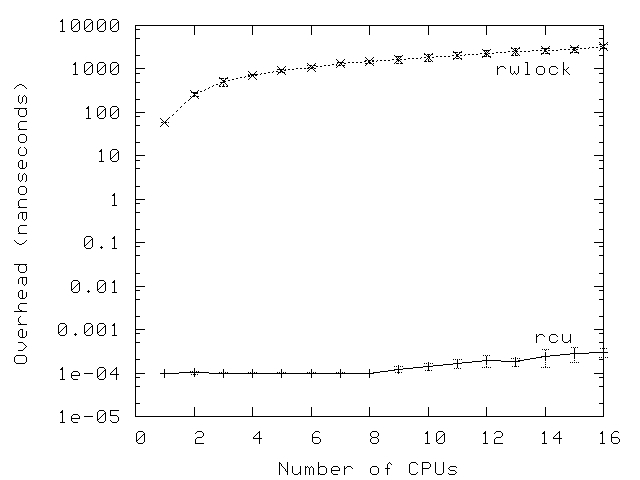

可以看到：单核场景下，读写锁的性能比 RCU 慢数个数量级；到 16 核时，读写锁又 *额外* 慢了接近两个数量级。与之相反，RCU 的扩展性非常好。两组测试里，误差棒（error bars）代表正负一个标准差。

**快速自测题 1**：WTF??? 3GHz 主频的时钟周期都超过 300 *皮秒（picosecond）* 了，你怎么能说 RCU 的开销只有 100 飞秒（femtosecond）？

开启`CONFIG_PREEMPT`（可抢占内核）后，差距会收敛（moderate）一些，但 RCU 依旧比读写锁快 1~3 个数量级。可以注意到，CPU 数量变多时，读写锁的测试波动（variability）非常大。误差棒同样代表正负一个标准差。

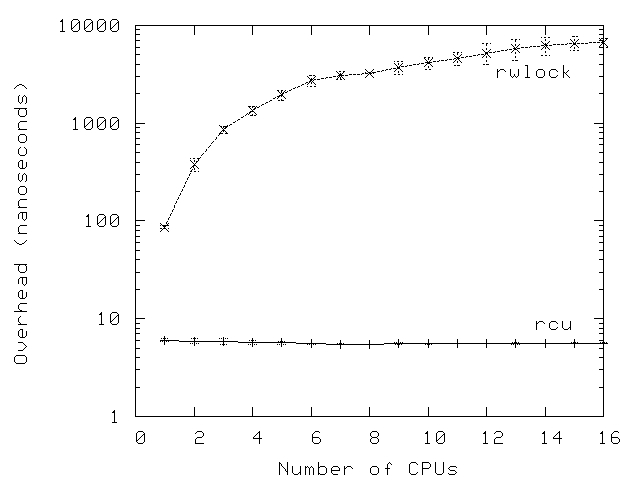

当然，当临界区内的计算开销变大时，读写锁本身的性能劣势就不再那么突出，16 核机器上的下图也印证了这点。

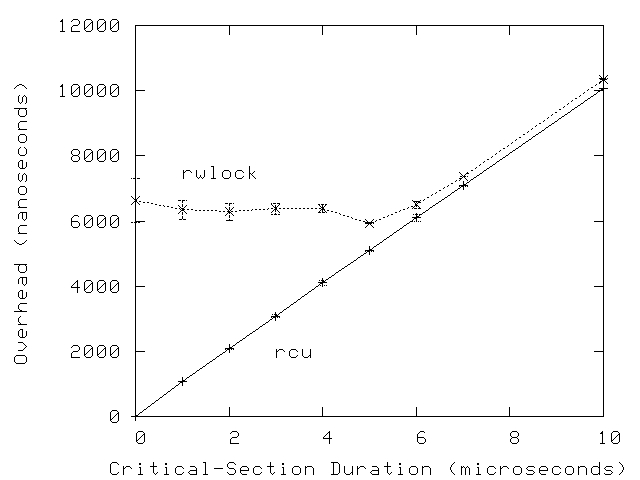

但这点需要辩证（tempered ）看待：不少系统调用（以及其中包含的 RCU 读端临界区）本身就能在数微秒内执行完毕。此外，下一节会讲到，RCU 读端原语几乎不会引发死锁。

**快速自测题 2**：为什么临界区自身开销变大时，rwlock 的开销和波动都会变小？

### 免死锁特性（Deadlock Immunity）
尽管在读多写少的负载场景下 RCU 具备显著的性能优势，但当初设计 RCU 最核心的原因之一，其实是它的读端不会引发死锁。该（immunity ）特性源于（stems from）：RCU 读端原语不会阻塞、不会自旋，甚至不存在反向分支（backwards branches），执行时间是确定的。因此，读端代码不可能参与到死锁环中。

**快速自测题 3**：这种免死锁特性是否存在例外？如果有，什么样的事件序列会引发死锁？

RCU 读端免死锁带来一个很有价值的推论：可以无条件地把 RCU 读端上下文升级为更新操作。如果用 **读写锁做同类的读转写升级，就会直接死锁**。下面是 RCU 读上下文升级到更新操作的示例代码：
```c
 1 rcu_read_lock();
 2 list_for_each_entry_rcu(p, head, list_field) {
 3   do_something_with(p);
 4   if (need_update(p)) {
 5     spin_lock(&my_lock);
 6     do_update(p);
 7     spin_unlock(&my_lock);
 8   }
 9 }
10 rcu_read_unlock();
```
注意：`do_update()` 是在自旋锁保护，*同时* 也在 RCU 读端保护下执行的。

RCU 免死锁特性带来的另一个好处：它可以规避一大类优先级反转问题。例如，低优先级的 RCU 读者不会阻碍高优先级的 RCU 更新者获取更新侧锁；同理，低优先级的 RCU 更新者也不会阻止高优先级的 RCU 读者进入 RCU 读端临界区。

### 实时延迟
RCU 读端原语既不会自旋，也不会阻塞，因此具备优异的实时延迟特性。此外前面也提到过：这意味着它可以避免一类由 RCU 读端原语与锁共同引发的优先级反转问题。

但是，RCU 仍会遇到更隐蔽的优先级反转场景。举例来说：在 `-rt` 实时内核中，一个高优先级进程阻塞等待 RCU 宽限期结束时，有可能被低优先级的 RCU 读者拖住。该问题可以通过 **[RCU 优先级提升（RCU priority boosting）](http://lwn.net/Articles/220677/)** 解决。

### RCU 读者与更新者并发执行
由于 RCU 读者既不会自旋也不会阻塞，并且更新操作不存在回滚或中止语义，RCU 的读者和更新者必然是并发运行的。这意味着 RCU 读者有可能读到旧数据，甚至观察到不一致状态。以上两点，使得从读写锁迁移到 RCU 并不是一件简单的事。

不过在相当多场景下，不一致和过期数据并不会造成问题。最经典的例子就是网络路由表：路由更新本身就需要很长时间才能抵达一台主机（数秒甚至数分钟），在更新到达之前，系统其实已经在错误转发报文很长一段时间了。再多维持几毫秒的旧路由转发，通常是可以接受的。
此外，RCU 更新者不需要等待读者完成就可以提交修改，因此 RCU 读者反而有可能比批处理公平读写锁的读者更早感知到变更，如下图所示。

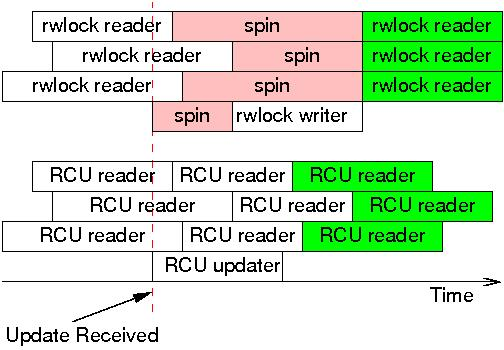

译注：左边的事件先发生，右边的事件后发生。RCU 的写者不阻塞读者，只是读者读到的数据有可能是旧的（发布前）也有可能是新的（发布后）。

更新抵达后，读写锁的写者必须等到最后一个读者完成才能继续；而后续新来的读者，也必须等写者执行完毕才能运行。但这些后续读者一定能读到新值，对应图中的绿色背景。

与之对比，RCU 的读者和更新者互不阻塞，因此 RCU 读者可以更早看到更新后的数据。当然，因为读者和更新者的执行时间存在重叠，*所有* RCU 读者都有可能读到新值，包括那三个在更新发起前就已经启动的读者。但只有图中标为绿色背景的 RCU 读者，才被 *保证* 一定读到新值。

读写锁与 RCU 提供的保证本身就不一样：

使用读写锁时，在写者启动（译注：拿到锁）之后才开始的读者，一定可以读到新值；而在写者自旋（译注：争用锁）期间尝试启动的读者能否读到新值，则取决于该读写锁实现是读优先还是写优先。

而 RCU 的规则是：在更新操作完成之后才启动的读者，一定读到新值；在更新操作启动之后才结束的读者，能否读到新值取决于时序。

这里的核心观点是：虽然读写锁确实能保证计算机系统内部的数据一致性，但在某些场景下，这种内部一致性的代价是 **和外部世界之间的不一致性变大**。换句话说，读写锁换来了系统内部一致，代价是默默持有相对于外部世界的过期数据。

当然，也存在一些场景，系统内部的不一致和过期数据是完全不可接受的。好在已经有不少方案可以规避这类问题，相关内容可以参考 [FREENIX 那篇将 RCU 应用于 System V IPC 的论文](http://www.rdrop.com/users/paulmck/RCU/rcu.FREENIX.2003.06.14.pdf) 以及我的 [博士论文](http://www.rdrop.com/users/paulmck/RCU/RCUdissertation.2004.07.14e1.pdf)。不过对这些方案的深入讨论超出了本文的范围。

### 低优先级 RCU 读者可能阻塞高优先级回收任务
实时 RCU、[SRCU](http://lwn.net/Articles/202847/) 和 [QRCU](http://lwn.net/Articles/243851/)（这三者都会在本系列最后一篇中介绍）存在这样一个现象：一个被抢占的读者会阻止宽限期结束，即便此时有高优先级任务正在阻塞、等待该宽限期完成。
实时 RCU 可以通过用 `call_rcu()` 替换 `synchronize_rcu()`，或者使用 [RCU 优先级提升机制](http://lwn.net/Articles/220677/) 来规避该问题；截至 2007 年末，RCU 优先级提升还处于实验阶段。未来或许也需要给 SRCU 和 QRCU 增加优先级提升能力，但前提是要先证明真实场景下确实存在这个需求。

### RCU 宽限期长达数毫秒
除 QRCU 之外，RCU 的宽限期通常会持续数毫秒。虽然有不少方法可以消除这类长延迟带来的负面影响，比如在条件允许时使用异步接口（`call_rcu()`、`call_rcu_bh()`），但这也是一条经验准则的核心原因：**RCU 适合在读多写少场景使用**。

### 读写锁与 RCU 代码对比
最优情况下，从读写锁迁移到 RCU 的改造非常简单，下面这个示例取自 [维基百科](http://en.wikipedia.org/wiki/Read-copy-update)。

```c
 1 struct el {                          1 struct el {
 2   struct list_head list;             2   struct list_head list;
 3   long key;                          3   long key;
 4   spinlock_t mutex;                  4   spinlock_t mutex;
 5   int data;                          5   int data;
 6   /* Other data fields */            6   /* Other data fields */
 7 };                                   7 };
 8 rwlock_t listmutex;                  8 spinlock_t listmutex;
 9 struct el head;                      9 struct el head;

 1 int search(long key, int *result)    1 int search(long key, int *result)
 2 {                                    2 {
 3   struct list_head *lp;              3   struct list_head *lp;
 4   struct el *p;                      4   struct el *p;
 5                                      5
 6   read_lock(&listmutex);             6   rcu_read_lock();
 7   list_for_each_entry(p, head, lp) { 7   list_for_each_entry_rcu(p, head, lp) {
 8     if (p->key == key) {             8     if (p->key == key) {
 9       *result = p->data;             9       *result = p->data;
10       read_unlock(&listmutex);      10       rcu_read_unlock();
11       return 1;                     11       return 1;
12     }                               12     }
13   }                                 13   }
14   read_unlock(&listmutex);          14   rcu_read_unlock();
15   return 0;                         15   return 0;
16 }                                   16 }

 1 int delete(long key)                 1 int delete(long key)
 2 {                                    2 {
 3   struct el *p;                      3   struct el *p;
 4                                      4
 5   write_lock(&listmutex);            5   spin_lock(&listmutex);
 6   list_for_each_entry(p, head, lp) { 6   list_for_each_entry(p, head, lp) {
 7     if (p->key == key) {             7     if (p->key == key) {
 8       list_del(&p->list);            8       list_del_rcu(&p->list);
 9       write_unlock(&listmutex);      9       spin_unlock(&listmutex);
                                       10       synchronize_rcu();
10       kfree(p);                     11       kfree(p);
11       return 1;                     12       return 1;
12     }                               13     }
13   }                                 14   }
14   write_unlock(&listmutex);         15   spin_unlock(&listmutex);
15   return 0;                         16   return 0;
16 }                                   17 }
```

更复杂的读写锁替换场景不在本文讨论范围内。

## RCU 是一种受限的引用计数机制
只要还有 RCU 读端临界区正在执行，宽限期就不能结束，基于这一点，RCU 读端原语可以当作一种受限的引用计数机制来使用。请看下面这段代码：
```c
1 rcu_read_lock();  /* 获取引用 */
2 p = rcu_dereference(head);
3 /* 使用 p 做一些操作 */
4 rcu_read_unlock();  /* 释放引用 */
```
可以把 `rcu_read_lock()` 理解成对指针 `p` 获取一个引用：在 `rcu_dereference()` 读取到 `p` 之后才启动的宽限期，必须等到对应的 `rcu_read_unlock()` 执行完之后才能够结束。
这套引用计数方案是 **受限** 的：RCU 读端临界区内不允许阻塞，也不允许把一个 RCU 读端临界区从一个任务转交（hand off）给另一个任务。

即便存在这些限制，下面这段代码也可以安全地释放 `p`：
```c
1 spin_lock(&mylock);
2 p = head;
3 head = NULL;
4 spin_unlock(&mylock);
5 synchronize_rcu();  /* 等待所有引用释放 */
6 kfree(p);
```
给 `head` 赋值为空，阻止后续代码再获取 `p` 的引用；`synchronize_rcu()` 则等待之前已经拿到的引用全部释放。

**快速自测题 4**：等等！这段代码和把 RCU 当成读写锁替代品时用的代码完全一样！这该怎么解释？

当然，RCU 也可以和传统引用计数组合使用，LKML（Linux 内核邮件列表）上已有相关讨论，[Overview of Linux-Kernel Reference Counting](http://open-std.org/jtc1/sc22/wg21/docs/papers/2007/n2167.pdf) 一文也做了总结。

但为什么要这么做（bother）？答案一部分仍然是性能，如下图所示，测试数据同样来自一台 16 核、3GHz Intel x86 机器。

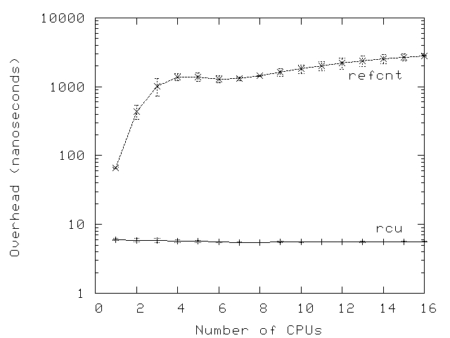

和读写锁的场景一样，RCU 的性能优势在临界区很短的时候最为突出，下图是 16 核机器上的测试结果。此外，和读写锁场景类似，很多系统调用（以及其中包含的 RCU 读端临界区）都能在数微秒内完成。

**快速自测题 5**：为什么引用计数的开销曲线在接近 6 核处出现一个低谷（dip）？

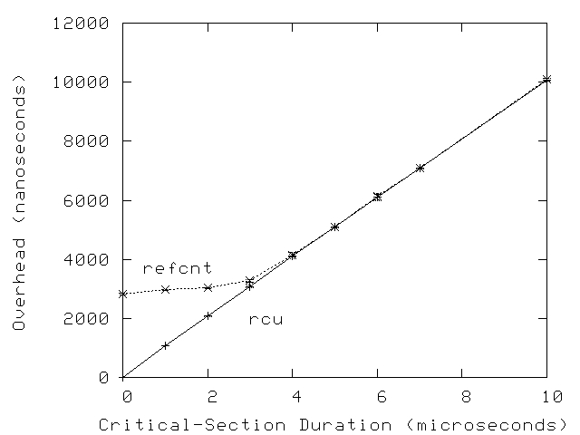

但是 RCU 附带的这些限制有时会非常苛刻（onerous）。举个例子：很多场景下，RCU 读端临界区内禁止睡眠这一条，会直接让方案无法落地。下一节会介绍解决该问题的办法，部分方案同时还能降低传统引用计数的复杂度。

## RCU 是一种批量引用计数机制

上一节提到，传统引用计数器通常绑定某一个特定数据结构，或者一组特定的数据结构。但如果为大量不同的数据结构维护同一个全局引用计数器，往往会造成存放该计数值的 cache lines 频繁乒乓（bouncing）。这种 cache-line bouncing 会严重损害性能。

与之相比，RCU 的轻量读端原语支持极高频率的读操作，而性能损耗几乎可以忽略不计，因此 RCU 可以作为 **批量引用计数（bulk reference-counting）** 机制使用，且几乎不带来性能损失。
如果需要让单个任务持有引用、并且在持有引用的代码段中允许阻塞，可以使用 [可睡眠 RCU（SRCU）](http://lwn.net/Articles/202847/)。
但还有一类很常见的场景 SRCU 无法很好覆盖：引用需要从一个任务传递给另一个任务。
例如，发起 I/O 时获取引用，在对应的 I/O 完成中断处理函数中释放引用。（理论上 SRCU 实现可以支持该场景，但实际上，目前还不清楚这么做是否是合适的取舍。）

当然，SRCU 本身也自带一条限制：`srcu_read_lock()` 的返回值必须传给对应的 `srcu_read_unlock()`。
该限制究竟会带来多大麻烦、以及最优的处理方式是什么，目前尚无定论。

## RCU：穷人版垃圾回收器
刚接触 RCU 的人经常会感慨（exclamation）：“RCU 有点像垃圾回收器！”这个说法有一定道理（grain of truth），但也容易造成误解。

理解 RCU 和自动垃圾回收器（GC）之间关系比较合适的方式是：二者的相似点在于，回收 *时机* 都是自动决定的；但 RCU 和 GC 也存在两点关键区别：
1. 程序员必须手动标记某个数据结构何时可以（eligible）被回收；
2. 程序员必须手动标出 RCU 读端临界区 —— 在这些区域内，可能合法（legitimately）持有对象引用。

尽管存在这些差异，二者的相似性其实很深，至少有一篇 RCU 的理论分析文章就提到了这一点。
另外，据我所知，第一个类 RCU 机制，就是依靠垃圾回收器来实现宽限期的。不过，下一节会介绍一种对 RCU 更贴切的理解方式。

## RCU 是一种提供存在性保证的机制

[Gamsa 等人的论文](http://www.usenix.org/events/osdi99/full_papers/gamsa/gamsa.pdf) 讨论了 **存在性保证（existence guarantees）**，并介绍了如何使用类似 RCU 的机制来提供这类保证（参见论文第 7 页的第 5 节）。
其核心效果是：只要在 RCU 读端临界区内访问某个受 RCU 保护的数据元素，就可以保证该数据元素在这个 RCU 读端临界区的整个生命周期内持续存在。

细心的读者会发现，这和最初 “RCU 是等待操作完成的一种手段” 这一核心观点差别很小，下一节将继续展开这个话题。

## RCU 是一种等待操作完成的方式
正如本系列第一篇文章所述，RCU 的一个核心组成部分，就是等待 RCU 读者执行完毕。
RCU 的一大优势：它可以等待成千上万个不同的操作完成，却不需要显式跟踪每一个操作；同时也规避了显式跟踪方案与生俱来的性能衰减、扩展性瓶颈、复杂死锁场景以及内存泄漏风险。

本节将说明：`synchronize_sched()` 对应的读端上下文（包括所有关闭抢占的代码、以及关闭中断的硬件操作和原语），如何实现与不可屏蔽中断（NMI）处理函数之间的同步交互。
如果使用传统锁，这类同步会非常棘手。
我在 [博士论文](http://www.rdrop.com/users/paulmck/RCU/RCUdissertation.2004.07.14e1.pdf) 中将这套方案命名为 **纯 RCU（Pure RCU）**，Linux 内核多处都用到了该机制。

这类“纯 RCU”设计的基本流程如下：
1. 执行变更，例如修改操作系统对 NMI 的响应方式。
2. 等待所有已经启动的读端临界区全部执行完毕（例如使用 `synchronize_sched()` 原语）。这里关键结论：之后新进入的 RCU 读端临界区一定能看到本次变更。
3. 收尾清理，例如返回状态，标识变更已成功完成。

本节后续给出改编自 Linux 内核的示例代码。例子里的 `nmi_stop` 函数借助 `synchronize_sched()`，保证在释放相关资源前，所有正在处理中的（in-flight）NMI 通知都已经执行完成。
下面是简化版代码：

```c
 1 struct profile_buffer {
 2   long size;
 3   atomic_t entry[0];
 4 };
 5 static struct profile_buffer *buf = NULL;
 6 
 7 void nmi_profile(unsigned long pcvalue)
 8 {
 9   atomic_t *p = rcu_dereference(buf);
10 
11   if (p == NULL)
12     return;
13   if (pcvalue >= p->size)
14     return;
15   atomic_inc(&p->entry[pcvalue]);
16 }
17 
18 void nmi_stop(void)
19 {
20   atomic_t *p = buf;
21 
22   if (p == NULL)
23     return;
24   rcu_assign_pointer(buf, NULL);
25   synchronize_sched();
26   kfree(p);
27 }
```

第 1–4 行定义了 `profile_buffer` 结构体，包含一个大小字段和长度不定的条目数组（indefinite array of entries）。
第 5 行定义一个指向性能采样缓冲区（profile buffer）的指针，该指针会在别处初始化，指向一块动态分配的内存。

第 7–16 行是 `nmi_profile()` 函数，该函数在 NMI 处理函数内部调用。
既然运行在 NMI 上下文，它不会被抢占，也不会被普通中断处理函数打断；但依然会因为 cache misses、ECC 纠错、同核心内其他硬件线程抢占周期（cycle stealing）而产生延迟。
第 9 行通过 `rcu_dereference()` 获取缓冲区的本地指针，用来保证 DEC Alpha 平台上的内存序；
第 11、12 行：如果当前没有分配缓冲区，直接退出；
第 13、14 行：如果入参 `pcvalue` 越界，也直接退出。
否则第 15 行按照 `pcvalue` 作为下标，对缓冲区对应条目计数加一。
注意：缓冲区自身携带 `size` 字段，保证范围检查和缓冲区匹配。即便一个大缓冲区突然被替换成更小的缓冲区，也不会出现越界访问。

第 18–27 行定义 `nmi_stop()` 函数，调用方需要自行保证互斥（例如持有对应的锁）。
第 20 行取出缓冲区指针；
第 22、23 行：缓冲区为空则直接返回。
否则第 24 行把全局缓冲区指针置空（使用 `rcu_assign_pointer()`，在弱序平台上维护内存序）；
第 25 行等待 RCU-sched 宽限期结束，也就是等待所有不可抢占代码段（包括 NMI 处理函数）全部执行完成。
执行走到第 26 行时，可以保证：所有拿到旧缓冲区指针的 `nmi_profile()` 调用都已经返回。此时就可以安全释放缓冲区，这里用 `kfree()`。

简言之，RCU 让动态切换性能采样缓冲区变得简单高效（你可以试试只用原子操作做到同等效率，或者用锁来实现这套逻辑，难度会非常高！）。
不过，正如前面小节展示的，RCU 通常在更高抽象层级上使用。

**快速自测题 6**：假设 `nmi_profile()` 允许被抢占，要做哪些修改才能让这个例子正确运行？

## 小结 2
RCU 的本质，就是一套 API，它提供：
- 用于新增数据的发布-订阅机制；
- 等待已启动 RCU 读者执行完毕的手段；
- 维护多版本数据的规范（discipline），使得修改操作不会破坏并发 RCU 读者，也不会造成不必要的延迟。

在此基础上，可以基于 RCU 构建高层抽象（higher-level constructs），包括前文介绍的读写锁、引用计数、存在性保证等机制。
此外，我毫不怀疑，Linux 社区还会持续挖掘 RCU 以及其他各类同步原语（synchronization primitive）新颖且有价值的用法。

## 自测题答案
**快速自测题 1**：WTF??? 3GHz 主频的时钟周期都超过 300 皮秒了，你怎么能相信 RCU 的开销只有 100 飞秒？

答：首先，本次测试所用的内层循环代码如下：
```c
1 for (i = 0; i < CSCOUNT_SCALE; i++) {
2   rcu_read_lock();
3   rcu_read_unlock();
4 }
```
其次，我们来看 `rcu_read_lock()` 和 `rcu_read_unlock()` 的等效定义：
```c
1 #define rcu_read_lock()   do { } while (0)
2 #define rcu_read_unlock() do { } while (0)
```
再加上编译器会做简单优化，直接把整个循环优化成：
```c
i = CSCOUNT_SCALE;
```
所以这个 100 飞秒的“测量值”，本质只是计时本身的固定开销，除以循环迭代次数得到的结果。
因此这个测量结果本身是错的，误差甚至可以达到任意多个数量级。从上面宏定义就能看到，**实际开销就是 0**。

能看到 100 飞秒的计时结果反而属于高估，这种情况可不常见！

**快速自测题 2**：为什么临界区自身开销变大时，rwlock 的开销和波动都会变小？

答：因为临界区开销变大后，底层 `rwlock_t` 的竞争程度下降。但受缓存颠簸（cache-thrashing）开销影响，读写锁的开销并不会降到单核场景下的水平。

**快速自测题 3**：RCU 读端免死锁特性是否存在例外？如果有，什么样的操作序列会引发死锁？

答：下面这一段（非法）代码序列，就会形成包含 RCU 读端原语的死锁环：
```c
idx = srcu_read_lock(&srcucb);
synchronize_srcu(&srcucb);
srcu_read_unlock(&srcucb, idx);
```
`synchronize_srcu()` 需要等待所有已经启动的 SRCU 读端临界区完成才会返回；但它本身又包裹在一个 SRCU 读端临界区里面，这个读端临界区又要等 `synchronize_srcu()` 返回才能结束。最终形成经典的自死锁 —— 和持有读写锁读锁时，再去申请写锁的效果一模一样。

注意：这个自死锁场景 **不适用于经典 RCU**。经典 RCU 里 `synchronize_rcu()` 会触发上下文切换，上下文切换本身就是该 CPU 的静默状态（quiescent state），宽限期可以正常完成。
但这反而更危险：宽限期完成之后，RCU 读端临界区正在访问的数据有可能被释放。

简而言之，**不要在 RCU 读端临界区里面调用同步类 RCU 更新原语**。

**快速自测题 4**：等等！这段代码和把 RCU 当成读写锁替代品时写的代码完全一样！这该怎么解释？

答：这是“示例代码定律（Law of Toy Examples）”带来的现象：简单示例写到一定程度，代码长得都会一样。唯一区别在于我们理解代码的角度。
但这个理解角度的差异至关重要。举个例子：如果我们把 RCU 理解成受限引用计数机制，就不会误以为更新操作会排斥 RCU 读端临界区。

当然，把 RCU 理解成读写锁替代品在很多场景下仍然很有用，比如你正在把读写锁迁移为 RCU 的时候。

**快速自测题 5**：为什么引用计数的开销曲线在接近 6 核处出现低谷？

答：极有可能是 NUMA 效应。另外从误差棒可以看到，引用计数这组测量值离散度很大，部分场景下标准差甚至超过测量值的 10%。所以这个开销低谷，也很可能只是统计上的偶然偏差。

**快速自测题 6**：假设 `nmi_profile()` 函数允许被抢占，要做哪些修改才能让这个例子正确运行？

答：一种方案是在 `nmi_profile()` 中使用 `rcu_read_lock()` / `rcu_read_unlock()`，并且把 `synchronize_sched()` 替换成 `synchronize_rcu()`，修改示意大致如下：

```c
 1 struct profile_buffer {
 2   long size;
 3   atomic_t entry[0];
 4 };
 5 static struct profile_buffer *buf = NULL;
 6 
 7 void nmi_profile(unsigned long pcvalue)
 8 {
 9   atomic_t *p;
10 
11   rcu_read_lock();
12   p = rcu_dereference(buf);
13   if (p == NULL) {
14     rcu_read_unlock();
15     return;
16   }
17   if (pcvalue >= p->size) {
18     rcu_read_unlock();
19     return;
20   }
21   atomic_inc(&p->entry[pcvalue]);
22   rcu_read_unlock();
23 }
24 
25 void nmi_stop(void)
26 {
27   atomic_t *p = buf;
28 
29   if (p == NULL)
30     return;
31   rcu_assign_pointer(buf, NULL);
32   synchronize_rcu();
33   kfree(p);
34 }
```

# References
- [LWN - What is RCU, Fundamentally?](https://lwn.net/Articles/262464/)
- [LWN - What is RCU? Part 2: Usage](https://lwn.net/Articles/263130/)
