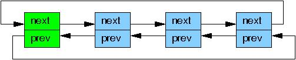
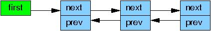
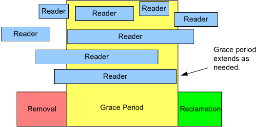

# What is RCU, Fundamentally?

## 引言
读-拷贝更新（RCU，Read-copy update）是 2002 年 10 月加入 Linux 内核的一种同步机制。RCU 通过允许读操作与更新操作并发执行，提升了系统的可扩展性。
传统锁原语会对所有并发线程（无论读者还是更新者）强制互斥；读写锁虽然支持并发读，但一旦存在更新就不允许读。和它们不同，RCU 支持 **一个更新者与多个读者并发运行**。
RCU 通过维护对象的多个版本、并且保证旧版本不会被释放，直到所有先前启动的读侧临界区全部执行完毕，以此保证读操作的一致性。
RCU 定义并使用一套高效、高可扩展的机制：用于发布、读取对象的新版本，同时延迟（deferring）回收旧版本。
这套机制把开销分摊到读路径和更新路径上，让 **读路径的开销极低**。在部分场景下（不可抢占内核），RCU 的读侧原语开销为零。

**快速自测题1：** 那顺序锁（seqlock）不也允许读端和更新端并发执行吗？

这就引出一个问题：“RCU 到底是什么？”，或许还会附带另一个问题：“RCU 这东西凭什么能正常工作？”（也经常会看到一种论调，说 RCU 根本就不可能正常工作）。
本文从底层原理角度解答这些问题；后续篇章会从使用方式和API接口的角度展开说明。最后一篇还会附上参考文献列表。

RCU 由三大基础机制构成：第一个用于插入操作，第二个用于删除操作，第三个让读端可以容忍并发的插入与删除。
下面分小节讲解这些机制，以 RCU 在链表上的应用为例展开说明：
- [发布-订阅机制](#发布-订阅机制publish-subscribe-mechanism)（Publish-Subscribe，用于插入）
- [等待已存在的 RCU 读端临界区执行完毕](#等待已启动的-rcu-读端临界区执行完毕)（用于删除）
- [为新近更新的对象维护多个版本](#为新近更新的对象维护多个版本)（服务于读端）

以上小节之后是 [总结] 以及 [快速自测题答案]。

## 发布-订阅机制（Publish-Subscribe Mechanism）

RCU 的一个核心特性：**即使数据正在被并发修改，读端依然可以安全地遍历该数据**。为支持并发插入，RCU 采用了一种可理解为发布-订阅的机制。
举个例子：有一个初始值为 `NULL` 的全局指针 `gp`，我们要修改它，让它指向一块刚分配并完成初始化的数据结构。
可以用下面这段代码片段（还需要搭配合适的锁保护）实现这个目的：
```c
struct foo {
   int a;
   int b;
   int c;
};
struct foo *gp = NULL;
 
/* . . . */

p = kmalloc(sizeof(*p), GFP_KERNEL);
p->a = 1;
p->b = 2;
p->c = 3;
gp = p;
```

但这段代码存在问题：**没有任何约束强制编译器和 CPU 按顺序执行最后四条赋值语句**。
如果对 `gp` 的赋值先于 `p` 成员字段的初始化完成，那么并发的读端就有可能读到未初始化的脏值。
这种场景需要内存屏障来保证顺序，而内存屏障本身以难用、容易出错著称。因此内核把屏障逻辑封装成原语 `rcu_assign_pointer()`，它自带 **发布语义（publication semantics）**。修改后最后四行代码如下：
```c
p->a = 1;
p->b = 2;
p->c = 3;
rcu_assign_pointer(gp, p);
```

`rcu_assign_pointer()` 负责 *发布* 这个新结构体：它会强制编译器与 CPU，保证对 `gp` 的赋值，一定在 `p` 指向的各个字段赋值完成 *之后* 执行。

但仅仅在更新端保证执行顺序还不够，**读端同样必须保证正确的访存顺序**。请看下面这段代码片段：
```c
p = gp;
if (p != NULL) {
    do_something_with(p->a, p->b, p->c);
}
```

这段代码乍一看似乎不会发生乱序问题，但不巧的是，[DEC Alpha CPU](http://www.rdrop.com/users/paulmck/scalability/paper/ordering.2007.09.19a.pdf)，以及 **值推测（value-speculation）** 类编译器优化，真的可以让 `p->a`、`p->b`、`p->c` 的读取先于指针 `p` 的读取！
用值推测优化的场景最好理解：编译器会预先猜测 `p` 的值，提前加载 `p->a`、`p->b`、`p->c`，之后再读取真实的 `p`，校验刚才的猜测是否成立。这类优化非常激进，甚至可以说近乎离谱，但在基于采样反馈的配置驱动优化（profile-driven optimization）中确实会出现。

显然，我们需要阻止编译器和 CPU 做出这类“小动作”。原语 `rcu_dereference()` 会按需插入内存屏障指令以及编译器屏障，用来达成这个目的：
```c
rcu_read_lock();
p = rcu_dereference(gp);
if (p != NULL) {
    do_something_with(p->a, p->b, p->c);
}
rcu_read_unlock();
```

因此可以把 `rcu_dereference()` 理解为 **订阅** 指定指针的取值：它能保证后续对该指针成员的解引用，一定可以看到对应发布操作（`rcu_assign_pointer()`）之前完成的全部初始化。
`rcu_read_lock()` 和 `rcu_read_unlock()` 是必不可少的：它们划定了 **RCU 读端临界区** 的范围。它们的作用会在下一节说明；重点是：这两个函数 **不会自旋、不会阻塞**，也不会阻止 `list_add_rcu()` 并发执行。实际上，在未开启 `CONFIG_PREEMPT` 的内核中，这两个调用不会生成任何机器码。

理论上，仅凭 `rcu_assign_pointer()` 和 `rcu_dereference()` 就可以构造任意受 RCU 保护的数据结构，但工程实践中，使用更高层封装会更方便。
所以这两个原语已经被封装进 Linux 链表操作 API 的 RCU 专用版本里。
Linux 提供两种双向链表：环形的 `struct list_head`，以及线性的 `struct hlist_head / struct hlist_node` 组合。
前者的布局如下，其中绿色方框代表链表头，蓝色方框代表链表节点。



把上面指针发布的示例改造为链表版本，代码如下：
```c
  1 struct foo {
  2   struct list_head list;
  3   int a;
  4   int b;
  5   int c;
  6 };
  7 LIST_HEAD(head);
  8 
  9 /* . . . */
 10 
 11 p = kmalloc(sizeof(*p), GFP_KERNEL);
 12 p->a = 1;
 13 p->b = 2;
 14 p->c = 3;
 15 list_add_rcu(&p->list, &head);
```

第 15 行需要通过某种同步机制（最常用的是锁）加以保护，避免多个 `list_add()` 并发执行。但这套同步机制 **不会阻止本次 `list_add_rcu()` 和 RCU 读端并发运行**。

订阅受 RCU 保护的链表也很简单：
```c
rcu_read_lock();
list_for_each_entry_rcu(p, head, list) {
  do_something_with(p->a, p->b, p->c);
}
rcu_read_unlock();
```

原语 `list_add_rcu()` 将一个节点发布到指定链表；它保证对应的 `list_for_each_entry_rcu()` 遍历宏可以正确订阅到这个新增节点。

**快速自测题2：** 如果 `list_for_each_entry_rcu()` 和 `list_add_rcu()` 恰好同时执行，是什么机制避免了段错误？

Linux 的另一种双向链表是哈希链表（hlist），它是线性链表。环形链表的链表头需要两个指针，而 hlist 的表头只需要一个指针。因此，在大容量哈希表的哈希桶数组中使用 hlist，可以将内存占用减少一半。



向受 RCU 保护的 hlist 发布新节点，操作和环形链表非常相似：
```c
  1 struct foo {
  2   struct hlist_node *list;
  3   int a;
  4   int b;
  5   int c;
  6 };
  7 HLIST_HEAD(head);
  8 
  9 /* . . . */
 10 
 11 p = kmalloc(sizeof(*p), GFP_KERNEL);
 12 p->a = 1;
 13 p->b = 2;
 14 p->c = 3;
 15 hlist_add_head_rcu(&p->list, &head);
```

和前面一样，第 15 行代码必须由同步机制（例如锁）保护。

遍历受 RCU 保护的 hlist 的方式也和环形链表类似：
```c
rcu_read_lock();
hlist_for_each_entry_rcu(p, q, head, list) {
  do_something_with(p->a, p->b, p->c);
}
rcu_read_unlock();
```

**快速自测题 3**：为什么 `hlist_for_each_entry_rcu()` 需要传入两个临时指针，而 `list_for_each_entry_rcu()` 只需要一个？

下表列出了全部 RCU 发布、订阅原语，另外还包含用于 “取消发布”（也就是撤销节点）的原语：

Category     | Publish              | Retract                       | Subscribe
-------------|----------------------|-------------------------------|-----------------
**Pointers** | rcu_assign_pointer() | rcu_assign_pointer(..., NULL) | rcu_dereference()
**Lists**    | list_add_rcu()</br>list_add_tail_rcu()</br>list_replace_rcu() | list_del_rcu() | list_for_each_entry_rcu()
**Hlists**   | hlist_add_after_rcu()</br>hlist_add_before_rcu()</br>hlist_add_head_rcu()</br>hlist_replace_rcu() | hlist_del_rcu() | hlist_for_each_entry_rcu()

需要注意，`list_replace_rcu()`、`list_del_rcu()`、`hlist_replace_rcu()`、`hlist_del_rcu()` 这几组接口会带来一个复杂问题：**什么时候才可以安全释放被替换或者被删除的数据节点？** 更具体一点：我们要如何确认，所有读端都已经不再持有该数据节点的引用？

下一节将解答这些问题。

## 等待已启动的 RCU 读端临界区执行完毕
从最根本的形态来看，RCU 就是一种等待任务完成的机制。当然，实现等待的方式还有很多，比如引用计数、读写锁、事件等等。
RCU 的突出优势在于：它可以同时等待（举例来说）20000 个不同的执行流结束，却不需要逐个显式追踪每一个；同时也不会出现显式追踪方案自带的性能下降、可扩展性瓶颈、复杂死锁场景以及内存泄露风险。

在 RCU 中，等待的对象叫做 **RCU 读端临界区**。一个 RCU 读端临界区以 `rcu_read_lock()` 原语开始，以配对的 `rcu_read_unlock()` 原语结束。
RCU 读端临界区支持嵌套，内部几乎可以放置任意代码，但 **不能主动阻塞或睡眠**（有一种特殊的 RCU 实现 [SRCU]，允许在它的读端临界区内睡眠）。
只要遵守这条规则，你就可以利用 RCU 等待指定代码段执行完成。

[经典 RCU] 和 [实时 RCU] 的相关文档里已经讲过：RCU 是通过间接判定的方式，获知这些读端何时执行完毕。

如下图所示：RCU 的作用，就是等待 **在删除操作之前就已经启动** 的那些 RCU 读端临界区全部执行完成，包括这些临界区内所有的内存访问操作。



但是请注意：**在某个宽限期（grace period）启动之后才开始的 RCU 读端临界区，完全可以、也确实会运行到该宽限期结束之后**。

下面这段伪代码展示了利用 RCU 等待读端完成的基础算法流程：
1. 执行修改操作，例如替换链表中的一个节点。
2. 等待所有在宽限期开始前就已启动的 RCU 读端临界区全部执行完毕（可以使用原语 `synchronize_rcu()`）。这里的核心逻辑是：**宽限期之后新产生的读端，已经无法拿到刚才被移除节点的引用**。
3. 清理资源，比如释放上面被替换掉的节点。

下面的代码片段改编自上一节示例，演示整个流程，其中成员 `a` 作为检索键：
```c
 1 struct foo {
 2   struct list_head list;
 3   int a;
 4   int b;
 5   int c;
 6 };
 7 LIST_HEAD(head);
 8 
 9 /* . . . */
10 
11 p = search(head, key);
12 if (p == NULL) {
13   /* 执行对应处理、解锁并返回 */
14 }
15 q = kmalloc(sizeof(*p), GFP_KERNEL);
16 *q = *p;
17 q->b = 2;
18 q->c = 3;
19 list_replace_rcu(&p->list, &q->list); //GP 开始，在此之前的读端看到的是旧链表，在此之后的读端看到的是新链表
20 synchronize_rcu();                    //GP 结束，阻塞式等待在删除操作之前就已经启动的那些 RCU 读端临界区全部执行完成
21 kfree(p);
```

第 19、20、21 行，正好对应上面所说的三步。
第 16～19 行的逻辑，正是 RCU（read-copy update，读-拷贝-更新）名字的由来：它允许 *读端* 并发访问；第 16 行执行拷贝，17–19 行完成 *更新*。

`synchronize_rcu()` 这个原语初看会有点难以理解：它需要等待全部旧的 RCU 读端临界区结束，而前面我们已经看到，在未开启 `CONFIG_PREEMPT` 的内核中，用来标记读临界区边界的 `rcu_read_lock()` 和 `rcu_read_unlock()` 甚至不会生成任何机器码！

这里有一个关键诀窍：经典 RCU 中由 `rcu_read_lock()` 和 `rcu_read_unlock()` 划定的读端临界区 **不允许阻塞或睡眠**。
因此，当某个 CPU 发生上下文切换时，我们就可以断定：该CPU 上之前启动的所有 RCU 读端临界区都已经执行完毕。
也就是说，只要每一个 CPU 都至少完成一次上下文切换，那么所有在此之前启动的 RCU 读端临界区必然全部结束，此时 `synchronize_rcu()` 就可以安全返回。

因此从原理上理解，经典 RCU 的 `synchronize_rcu()` 可以简化成下面这样：
```c
1 for_each_online_cpu(cpu)
2    run_on(cpu);
```

其中 `run_on()` 会把当前线程调度到指定 CPU 上运行，强制该 CPU 产生一次上下文切换。
这个 `for_each_online_cpu()` 循环会让每个在线 CPU 都发生一次上下文切换，以此保证所有先前的 RCU 读端临界区执行完成。
这种简单思路适用于 RCU 读临界区内禁止抢占的内核，也就是 `CONFIG_PREEMPT` 和非抢占内核；**但不适用于 `CONFIG_PREEMPT_RT` 实时（-rt）内核**。所以实时 RCU 采用了一套不同的实现方案，大体上基于引用计数思想。

当然，Linux 内核里的真实实现要复杂得多：它需要处理中断、NMI、CPU 热插拔以及商用内核里的各类异常场景，同时还要保证不错的性能与可扩展性。
而 RCU 的实时版本还必须保障良好的实时响应延迟，因此像上面这种依赖关闭抢占的简易实现就不可用了。

理解 `synchronize_rcu()` 这个简化原理很有帮助，但还有别的问题待解答。例如：读端遍历一个正在被并发更新的链表时，到底会读到什么内容？下一节就来回答这个问题。

## 为新近更新的对象维护多个版本
本节将说明 RCU 如何维护链表的多版本，从而支持无需同步的读端。
文中给出两个示例，用来阐释一条核心规则：只要某个读端还处在 RCU 读端临界区内，该读端可能正在引用的节点就必须保持完好可用。
第一个示例演示链表节点的删除，第二个演示节点替换。

## References
- [LWN - What is RCU, Fundamentally?](https://lwn.net/Articles/262464/)
